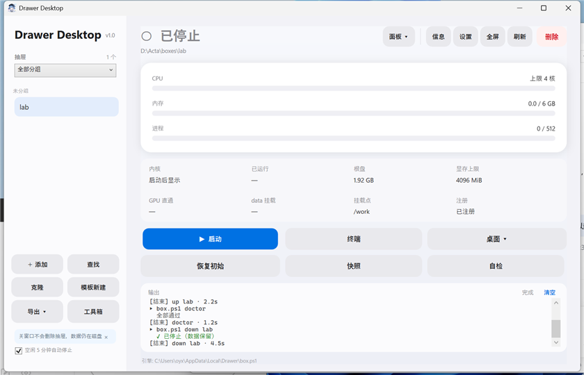

# Drawer Desktop

A WSL2 drawer manager for Windows. One folder is one Linux environment: build it, run it, snapshot it, delete it.



[中文](README.md) · [Code signing policy](CODE_SIGNING_POLICY.md) · [Privacy](PRIVACY.md)

## Requirements

- Windows 10 21H2+ or Windows 11, with WSL2
- [.NET 8 Desktop Runtime](https://dotnet.microsoft.com/download/dotnet/8.0/runtime)

## Install

Download `drawer-setup.exe` from [Releases](https://github.com/Falling-snow-o/drawer-desktop/releases) and run it.

```powershell
drawer-setup.exe --quiet          # silent install
drawer-setup.exe --uninstall      # uninstall
drawer-setup.exe --rollback       # restore the previous install
```

Self-signed builds: trust the certificate once before installing.

```powershell
powershell -ExecutionPolicy Bypass -File signing\Trust-DevCert.ps1
```

## Quick start

```powershell
box.ps1 add D:\work\demo
box.ps1 build demo
box.ps1 up demo
box.ps1 exec demo bash
box.ps1 snap demo before-upgrade
box.ps1 down demo
```

In the GUI: Add → Start → Terminal / Snapshot / Delete.

## Commands

| Command | What it does |
|---|---|
| `box.ps1 list` | List drawers (JSON) |
| `box.ps1 add <dir> [-Name name]` | Register a directory as a drawer |
| `box.ps1 build <name>` | Download rootfs and register the WSL distro |
| `box.ps1 up/down <name>` | Start / stop |
| `box.ps1 exec <name> [cmd]` | Run inside the drawer (default bash) |
| `box.ps1 gui <name> [app]` | Open a GUI window (default file manager) |
| `box.ps1 desktop <name>` | Full XFCE desktop in one window |
| `box.ps1 snap <name> <tag>` | Snapshot |
| `box.ps1 snap-restore <name> <tag>` | Restore |
| `box.ps1 status <name>` | Resource usage |
| `box.ps1 remove <name> [-y]` | Delete the drawer, including `data/` |
| `box.ps1 doctor` | Self-check |

`box.ps1 help` lists everything.

## How it works

- Each drawer is its own WSL2 distro; the vhdx lives in `state/`, deleting the folder uninstalls it.
- `data/` is mounted at `/work`, `downloads/` at `/downloads`; neither is touched by "restore".
- `box.yaml` sets CPU / memory / PID limits via cgroup v2, and an optional VRAM cap.
- Snapshots are tar + sha256; restic is optional.
- Drawers are independent and never modify `.wslconfig`.

## Collaboration (optional)

`data/` can be a git repository; environment changes are tracked as package manifests.

```powershell
box.ps1 collab demo init <remote>
box.ps1 collab demo sync -m "message"
box.ps1 collab demo merge master
```

See [COLLAB.md](COLLAB.md).

## Build and test

```powershell
powershell -File 打包.ps1 -Version 1.0.0
```

Output: `dist\drawer-setup.exe`, `dist\latest.json`.

```powershell
powershell -File test\ci.ps1           # syntax + build
powershell -File test\smoke.ps1        # engine
powershell -File test\collab-smoke.ps1 # collaboration
powershell -File test\gui-smoke.ps1    # GUI, requires installed app
```

## Updates and rollback

Set the `latest.json` URL in Settings, then **Panel → Check for updates**.

Update flow: download → verify sha256 → installer stops the app → backup → replace → restart.

Crash reports are written to `%USERPROFILE%\.boxrun\crashes\`.

## Code signing policy

Free code signing provided by [SignPath.io](https://about.signpath.io), certificate by [SignPath Foundation](https://signpath.org).

- Committers / reviewers / approvers: [Falling-snow-o](https://github.com/Falling-snow-o)
- Details: [CODE_SIGNING_POLICY.md](CODE_SIGNING_POLICY.md)

Local builds use a self-signed certificate; see [signing/README.md](signing/README.md).

## License

MIT, see [LICENSE](LICENSE). Third-party notices: [THIRD-PARTY-NOTICES.md](THIRD-PARTY-NOTICES.md).
Security model: [SECURITY.md](SECURITY.md).
