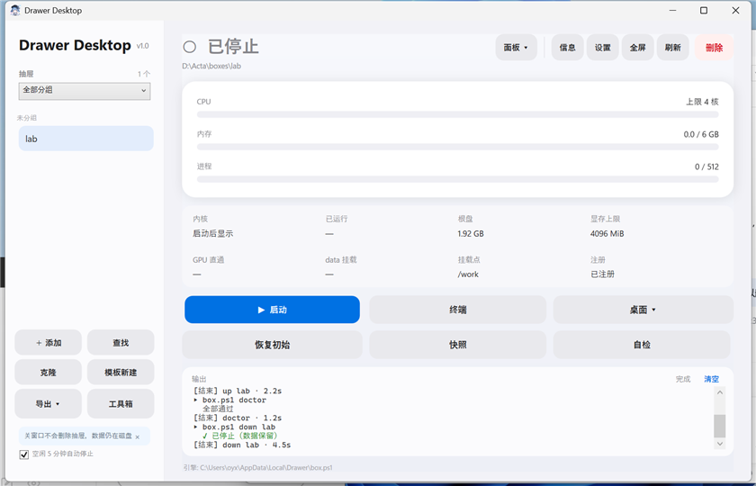

# Drawer Desktop

Windows 上的 WSL2 抽屉管理器。一个目录就是一个 Linux 环境：能装、能停、能快照、能删。



[English](README.en.md) · [签名政策](CODE_SIGNING_POLICY.md) · [隐私](PRIVACY.md)

## 需要

- Windows 10 21H2+ 或 Windows 11，WSL2
- [.NET 8 桌面运行时](https://dotnet.microsoft.com/download/dotnet/8.0/runtime)

## 安装

从 [Releases](https://github.com/Falling-snow-o/drawer-desktop/releases) 下载 `drawer-setup.exe`，双击。

```powershell
drawer-setup.exe --quiet          # 静默安装
drawer-setup.exe --uninstall      # 卸载
```

自签名版本的第一次运行前，先信任证书（不需要管理员）：

```powershell
powershell -ExecutionPolicy Bypass -File signing\Trust-DevCert.ps1
```

## 五分钟上手

```powershell
box.ps1 add D:\work\demo
box.ps1 build demo
box.ps1 up demo
box.ps1 exec demo bash
box.ps1 snap demo before-upgrade
box.ps1 down demo
```

界面里就是：添加 → 启动 → 终端 / 快照 / 删除。

## 常用命令

| 命令 | 作用 |
|---|---|
| `box.ps1 list` | 列出抽屉（JSON） |
| `box.ps1 add <目录> [-Name 名字]` | 把目录登记成抽屉 |
| `box.ps1 build <名字>` | 下载 rootfs 并注册 WSL 发行版 |
| `box.ps1 up/down <名字>` | 启动 / 停止 |
| `box.ps1 exec <名字> [命令]` | 在抽屉里执行，默认 bash |
| `box.ps1 gui <名字> [程序]` | 开图形窗口，默认文件管理器 |
| `box.ps1 desktop <名字>` | 开完整 XFCE 桌面 |
| `box.ps1 snap <名字> <标签>` | 快照 |
| `box.ps1 snap-restore <名字> <标签>` | 还原快照 |
| `box.ps1 status <名字>` | 资源占用 |
| `box.ps1 remove <名字> [-y]` | 删除抽屉（含 data/） |
| `box.ps1 doctor` | 自检 |

完整列表看 `box.ps1 help`。

## 它是怎么工作的

- 每个抽屉是独立的 WSL2 发行版，vhdx 在 `state/`，删目录就卸载
- `data/` 挂到箱内 `/work`，`downloads/` 挂到 `/downloads`，恢复初始不会删
- `box.yaml` 里用 cgroup v2 限 CPU / 内存 / 进程数；`gpu.vram` 限显存
- 快照是 tar + sha256；装了 restic 可以走增量
- 多个抽屉互不影响，也不碰 `.wslconfig`

## 协作（可选）

`data/` 可以当 git 仓库用，环境差异走包清单：

```powershell
box.ps1 collab demo init <远端>
box.ps1 collab demo sync -m "说明"
box.ps1 collab demo merge master
```

细节见 [COLLAB.md](COLLAB.md)。

## 构建与测试

```powershell
powershell -File 打包.ps1 -Version 1.0.0
```

产物：`dist\drawer-setup.exe`、`dist\latest.json`。

```powershell
powershell -File test\ci.ps1           # 语法 + 编译
powershell -File test\smoke.ps1        # 引擎
powershell -File test\collab-smoke.ps1 # 协作
powershell -File test\gui-smoke.ps1    # 界面（需已安装）
```

## 更新与回滚

设置里填 `latest.json` 地址，面板 → 检查更新。

```powershell
drawer-setup.exe --rollback --quiet    # 回到上一版
```

更新流程：下载 → sha256 校验 → 安装器停进程 → 备份 → 覆盖 → 重启。
崩溃日志在 `%USERPROFILE%\.boxrun\crashes\`。

## 代码签名

Free code signing provided by [SignPath.io](https://about.signpath.io), certificate by [SignPath Foundation](https://signpath.org).

- Committers / reviewers / approvers: [Falling-snow-o](https://github.com/Falling-snow-o)
- 详见 [CODE_SIGNING_POLICY.md](CODE_SIGNING_POLICY.md)

本地测试用自签名证书，见 [signing/README.md](signing/README.md)。

## 许可

MIT，见 [LICENSE](LICENSE)。第三方组件见 [THIRD-PARTY-NOTICES.md](THIRD-PARTY-NOTICES.md)。
安全边界见 [SECURITY.md](SECURITY.md)。
